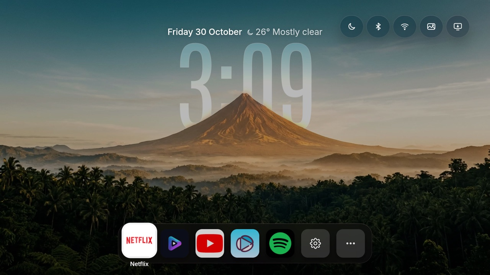

# couch-tv on a Fire TV Stick

This fork runs couch-tv's on-TV app (`dev.couchtv.ontv`, option C) as the home screen of a
**Fire TV Stick 4K (2nd gen, model AFTKM) on Fire OS 8.1.8.5 (Android 11)**. Everything below was
done on that stick. Other Fire OS 7 and 8 sticks should behave the same; sticks on **Vega OS**
cannot sideload apps at all.



## What this fork adds

- **Bluetooth and Network buttons** at the top right of the home. Fire OS's long-press Home menu
  has neither. On a Fire TV they open Amazon's own screens (Fire OS has no Bluetooth settings
  action); other TVs get Android's standard ones.
- **Home settings that change the look now take effect.** The on-TV app's WebView cancelled every
  page load, including the home's own reload, so the Look button, switching scenes on or off and
  the scene timer were saved but never shown. It now lets the home page reload itself.
- **TV settings opens.** Android's plain Settings action goes through Amazon's home on its way to
  Fire OS's Settings screen, so the Home watcher sent you straight back. couch-tv now opens that
  screen (`com.amazon.tv.launcher/.ui.MainSettingsActivity`) by name, and the watcher leaves
  Amazon's settings screens alone.
- **Builds that install over each other.** GitHub signs each build with a fixed key from the
  `DEBUG_KEYSTORE` secret, so an update keeps the app's settings and grants
  ([Signing](#signing-your-own-builds)).

## What works, and what does not

| | |
|---|---|
| Home screen, clock, scenes, weather, dock | Yes |
| Home button brings couch-tv back | Yes. Amazon's home flashes up for a moment first: Fire OS allows nothing better without root |
| Survives a restart | Yes (the accessibility watcher stays on) |
| Bluetooth button | Yes. If parental controls are on, Fire OS asks for the Prime Video PIN first |
| Network button | Yes |
| Gear tile: Home settings, TV settings | Yes (TV settings opens Fire OS's own Settings) |
| One scene only, or Classic look | Yes: switch the other scenes off in Home settings, Look and scenes; the home reloads with your choice |
| Phone remote | Opening apps works without ADB. Keys, typing and "what's playing" need the TV's own ADB (Connect ADB in the app) |
| Keep watching | Only fills from shows started from the phone remote |

## Install

You need a computer with `adb` (macOS: `brew install --cask android-platform-tools`) on the same
network as the stick.

1. **Developer options.** Settings, My Fire TV, About: press the device name seven times. Then
   Settings, My Fire TV, Developer options: **ADB debugging** on.
2. **Find the stick's address.** Settings, My Fire TV, About, Network. It changes when the stick
   joins another network (a phone hotspot, say), so look again after a move. A DHCP reservation in
   the router keeps it fixed.
3. **Connect**, then press **Allow** on the TV (tick "Always allow from this computer"):
   ```sh
   adb connect <stick-ip>:5555
   ```
4. **Install** `couch-tv-ontv.apk` (from this fork's Actions build, or the upstream Releases page):
   ```sh
   adb -s <stick-ip>:5555 install couch-tv-ontv.apk
   ```
5. **Open Couch TV** on the stick and press **Use as home screen**. Skip Connect ADB unless you
   want the phone remote's keys.
6. **Two grants** so it can take the Home key back (they survive restarts):
   ```sh
   adb -s <stick-ip>:5555 shell pm grant dev.couchtv.ontv android.permission.WRITE_SECURE_SETTINGS
   adb -s <stick-ip>:5555 shell appops set dev.couchtv.ontv SYSTEM_ALERT_WINDOW allow
   ```
   (On Fire OS 8.1.8.5 the second was already `allow` after install; running it does no harm.)
7. **Press "Use as home screen" after the grants** (if it was already on, press it off and on
   again). The app switches its accessibility watcher on when that switch is pressed and at every
   boot, and it needs the grant to be there first. Check it took:
   ```sh
   adb -s <stick-ip>:5555 shell settings get secure enabled_accessibility_services
   ```
   The answer should include `dev.couchtv.ontv/dev.couchtv.ontv.WatchService`. If it does not,
   add it yourself (keep anything already in the list, joined with `:`):
   ```sh
   adb -s <stick-ip>:5555 shell settings put secure enabled_accessibility_services dev.couchtv.ontv/dev.couchtv.ontv.WatchService
   ```
8. Press Home from any app: couch-tv comes back.

## Settings

The gear tile in the dock opens Home settings (weather place, apps, quick buttons, look). They can
also be set from a computer through the app's API, after pairing like a phone (the code shows on
the TV):

```sh
curl -X POST http://<stick-ip>:5400/api/pair/start
curl -X POST http://<stick-ip>:5400/api/pair -H 'Content-Type: application/json' -d '{"pin":"<code>","name":"My computer"}'
# returns {"token": ...}; send it as  Authorization: Bearer <token>
```

- `POST /api/settings` with `weather` (`lat`, `lon`, `place`, `timezone`), `country` (two
  letters), `people`, and `settings.hidden_apps` (packages to hide completely).
- `POST /api/app-order` with `order` (packages, first ones first) and `line` (how many sit in the
  dock before Settings and More apps).

**Forget phones** on the Couch TV screen signs every phone and computer out again.

## Things that will save you time

- **Fire OS 8.1.8 protects most Amazon apps.** `pm uninstall --user 0` fails with
  `DELETE_FAILED_INTERNAL_ERROR` for nearly all of them; `pm disable-user --user 0` works for most.
  Never touch `com.amazon.tv.launcher`: couch-tv relies on it staying put, and the stick can lose
  its home without it.
- **Only one Home watcher at a time.** If another launcher (Projectivy, Wolf) also overrides the
  Home key, they fight. Turn the other one's override off; it can stay installed as a fallback.
- **The Bluetooth screen asks for a PIN** when Amazon parental controls are on. That is Fire OS,
  not couch-tv.
- **Uninstalling the app removes its watcher and grants.** After a reinstall, redo Install steps
  5 to 7. An update (`adb install -r`, same signing key) keeps everything.
- **Restart the stick after an update if Home lands on Amazon's home.** Fire OS keeps the watcher
  switched on but does not always reconnect it after the app is updated (seen on 8.1.8.5). A
  restart reconnects it. To check: `adb shell dumpsys accessibility | grep "Bound services"`
  should list "Couch TV home watch".
- **The setup screen remembers which button had focus.** Count your D-pad presses from what is
  highlighted, not from the left: it is easy to press Forget phones by mistake.
- **Weather defaults to Sydney** until you set a place in Home settings or through the API.
- **A fork's first GitHub build needs Actions switched on** (the fork's Actions tab, "I understand
  my workflows"). Builds then run on every push.

## Signing your own builds

Android only installs an update signed with the same key as the app already on the TV. GitHub
makes a new debug key for every run unless the fork has a fixed one:

1. Make a key (any computer with `openssl`):
   ```sh
   openssl req -x509 -newkey rsa:2048 -nodes -keyout key.pem -out cert.pem -days 10950 -subj "/CN=Android Debug/O=Android/C=US"
   openssl pkcs12 -export -inkey key.pem -in cert.pem -name androiddebugkey -passout pass:android -out couchtv.keystore
   rm key.pem
   base64 -i couchtv.keystore | tr -d '\n' | pbcopy      # macOS; on Linux: base64 -w0 couchtv.keystore
   ```
2. Add it to the fork: Settings, Secrets and variables, Actions, **New repository secret**, name
   `DEBUG_KEYSTORE`. (It must be a repository secret, not an environment secret or a variable.)
3. Push. The build log's **Which key signed them** step prints the fingerprint; it should match
   `openssl x509 -in cert.pem -noout -fingerprint -sha256`.
4. The first install signed with the new key has to replace the old one once
   (`adb uninstall dev.couchtv.ontv`, then install). That clears the app's settings and the
   `WRITE_SECURE_SETTINGS` grant, so redo Install steps 5 to 7. From then on, `adb install -r`
   keeps everything.

Keep the keystore out of the repo. Locally, `COUCHTV_KEYSTORE=/path/to/couchtv.keystore sh
scripts/build-apk.sh` signs with the same key.

## Undo

Open Couch TV and press **Stop being the home screen**, or remove it:

```sh
adb -s <stick-ip>:5555 uninstall dev.couchtv.ontv
```

Amazon's home is back on the Home key straight away.
